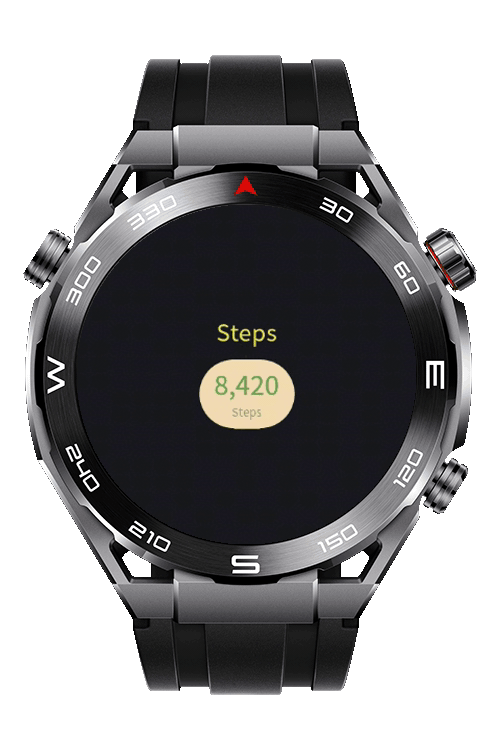
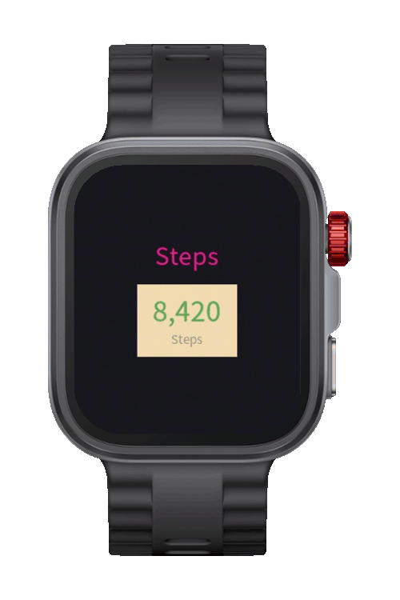
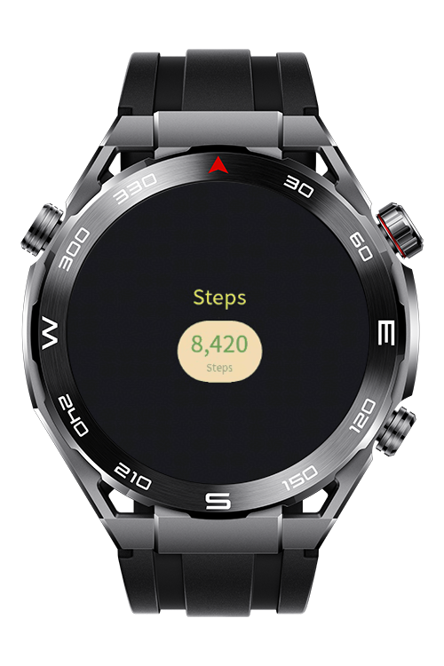

> **Note:** To access all shared projects, get information about environment setup, and view other guides, please visit [Explore-In-HMOS-Wearable Index](https://github.com/Explore-In-HMOS-Wearable/hmos-index).

# How To Use Mediaquery

This application(how-to-use-media-query) shows you how to use CSS media queries in a HarmonyOS lite wearable app to adapt a single layout to different devices based on screen shape, size and other device characteristics.

# Preview
<p>
    
    
    
</p>

# Use Cases

- Adapt font sizes, spacing and component dimensions to small and large watch screens.
- Detect whether the device screen is round or rectangular and adjust the layout according to that.
- Show or hide interface elements depending on the device's screen characteristics.

# Tech Stack
**Languages**: JS, HML, CSS  
**Frameworks**: HarmonyOS SDK 5.0.0(12)
**Tools**: DevEco Studio 6.1.1  
**Libraries/Kits**:
- @media

# Directory Structure
```
└── js
    └── MainAbility
        └── pages
            └── index
                ├── index.css
                ├── index.hml
                ├── index.js
        └── app.js
```

# Constraints and Restrictions

## Supported Device
- Huawei Sport (Lite) Watch GT 4/5/6
- Huawei Sport (Lite) GT4/5/6 Pro
- Huawei Sport (Lite) Fit 3/4/5
- Huawei Sport (Lite) D2
- Huawei Sport (Lite) Ultimate
- Huawei Sport (Lite) GT Runner 2

# License

**How To Use Mediaquery** is distributed under the terms of the **MIT License**.  
See the [LICENSE](LICENSE) file for more information.  